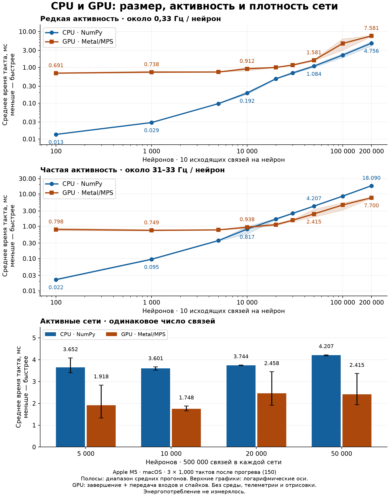

# Spiking Bug

Локальная лаборатория импульсных нейронных сетей: **редактор коннектома** и
**среда с жуком**, открытые в двух независимых веб-интерфейсах. Один Python-сервер
вычисляет нервную систему и мир; запуск, настройки и назначения нейронов общие
для обоих окон.

В проекте есть LIF-нейроны с непрерывной утечкой, прямые и модулирующие синапсы,
генерация ганглиев и связей между ними, лабиринты, пища и преследующие угрозы.
Расчёт сети можно переключать между **CPU / NumPy**, **Apple GPU / Metal (MPS)**
и **NVIDIA GPU / CUDA**. Автоматического обучения весов нет: поведение задаётся
построенной сетью.

[Запуск](#запуск) · [Первые шаги](#первые-шаги) ·
[Среда](#работа-со-средой) · [Редактор](#работа-с-редактором) ·
[Модель](#как-работает-нейронная-сеть) · [Производительность](#производительность) ·
[Разработка](#разработка)

## Запуск

Нужны **Python 3.10+**, **Node.js 22.12+** и npm. Проверенная локальная конфигурация:
Python 3.13 и Node.js 24 на macOS / Apple Silicon. Команды выполняются из корня
скачанного или клонированного проекта. Для CPU PyTorch не требуется.

### macOS и Linux

```bash
./setup.sh
./run.sh
```

Установка создаёт `.venv`, устанавливает Python- и npm-зависимости и собирает
оба клиента. Повторный запуск — только `./run.sh`. На Linux должны быть доступны
`venv` и `pip` для выбранного Python. При необходимости укажите интерпретатор:
`PYTHON=/path/to/python3 ./setup.sh`.

На macOS можно также открыть `start.command`: при отсутствии `.venv` или
`node_modules` он сначала выполнит установку.

### Windows — PowerShell

```powershell
python -m venv .venv
.venv\Scripts\python.exe -m pip install --upgrade pip
.venv\Scripts\python.exe -m pip install -r requirements.txt
npm ci
npm run build
.venv\Scripts\python.exe scripts/dev.py
```

Для последующих запусков нужна только последняя команда. Активация виртуального
окружения не обязательна. Не переносите `.venv` и `node_modules` между ОС:
создавайте их на целевой машине.

### Адреса и остановка

| Компонент | Адрес                                   | Назначение                                      |
| :-------- | :-------------------------------------- | :---------------------------------------------- |
| Среда     | [127.0.0.1:5173](http://127.0.0.1:5173) | Арена, жук, объекты и сенсорные/моторные каналы |
| Редактор  | [127.0.0.1:5174](http://127.0.0.1:5174) | Нейроны, синапсы, ганглии и активность          |
| API       | [127.0.0.1:8000](http://127.0.0.1:8000) | Общее состояние симуляции                       |

Откройте оба клиента в отдельных вкладках или окнах. Симуляция стартует **на паузе**.
`Ctrl+C` в терминале останавливает все три процесса. Если порт занят, launcher
сообщит об этом и завершится. Серверы слушают только `127.0.0.1`.

### Включение GPU

Для Apple Silicon установите дополнительные зависимости, затем запустите сервер:

```bash
./setup.sh --gpu
./run.sh
```

В уже установленном проекте достаточно установить пакет и перезапустить сервер:

```bash
.venv/bin/python -m pip install -r requirements-gpu.txt
```

Для NVIDIA установите в **виртуальное окружение проекта** сборку PyTorch с CUDA,
совместимую с вашей ОС и драйвером. Команду выбирайте в
[официальном установщике PyTorch](https://pytorch.org/get-started/locally/);
проект использует `torch>=2.8,<3`, без `torchvision` и `torchaudio`.
В выбранной команде замените `pip` / `pip3` на `.venv/bin/python -m pip`
(Linux) или `.venv\Scripts\python.exe -m pip` (Windows).

После запуска в общей панели управления, рядом с темпом, выберите **«Расчёт»**:

| Режим                   | Вычислитель                                      | Статус проверки                                   |
| :---------------------- | :----------------------------------------------- | :------------------------------------------------ |
| CPU · NumPy             | Процессор                                        | Локальные тесты и замеры на macOS / Apple M5      |
| GPU · Apple Metal (MPS) | Apple Silicon, macOS                             | Локальные тесты и замеры на Apple M5              |
| GPU · CUDA              | NVIDIA, Linux или Windows с CUDA-сборкой PyTorch | Реализован; на CUDA-оборудовании пока не проверен |

Linux и Windows имеют инструкции запуска, но в опубликованные аппаратные замеры
не входят. AMD/ROCm и DirectML сейчас не представлены в выборе устройств.

Недоступные устройства отключены в списке; подсказка объясняет причину.
Переключение сохраняет потенциалы, рефрактерность, чувствительность, отложенные
импульсы и время модели. Ставить симуляцию на паузу не требуется. Выбор общий
для двух клиентов и сохраняется после перезапуска. Если сохранённый GPU больше
недоступен, сервер использует CPU и показывает пояснение.

GPU вычисляет **нервную систему**. Среда, обработка сенсоров и подготовка
телеметрии остаются на CPU. Для небольшой сети CPU обычно выгоднее — см.
[измерения ниже](#производительность).

## Первые шаги

1. Откройте среду и редактор. Нажмите **«Запустить»**: демонстрационная сеть
   начнёт управлять жуком.
2. Поставьте симуляцию на паузу. В среде щёлкните по арене и попробуйте **W/A/S/D**
   или стрелки. Ручное управление работает и без назначенных моторных нейронов.
3. В редакторе выберите нейрон: справа появятся параметры, состояние и связанные
   с ним каналы среды. Нажмите **«Импульс +2»**, затем **«Такт»**, чтобы обработать импульс.
4. Создайте пару нейронов инструментом **⊕**, соедините их инструментом **↗**
   и задайте вес и задержку в инспекторе.
5. В среде откройте **«Нейроны»**, назначьте ID сенсорным и моторным каналам,
   нажмите **«Сохранить назначения»**. Проверьте эти назначения в редакторе.
6. Нажмите **«Экспорт»**, чтобы скачать переносимый JSON эксперимента.

### Общая панель и навигация

| Элемент           | Действие                                                                            |
| :---------------- | :---------------------------------------------------------------------------------- |
| Запустить / Пауза | Управляет одной общей симуляцией в обоих окнах                                      |
| Такт              | На паузе выполняет один шаг модели длительностью 10 мс                              |
| Сброс             | Останавливает симуляцию, сбрасывает состояние сети и возвращает жука в точку старта |
| Темп              | Меняет скорость течения времени модели; шаг интегрирования остаётся 10 мс           |
| Расчёт            | Выбирает CPU или доступный GPU                                                      |
| Колесо, − / ＋    | Масштабирует поле; колесо приближает область под указателем                         |
| ↔ Панорама        | Перемещает камеру перетаскиванием                                                   |
| ⊡ Вписать всё     | Возвращает всю сцену в видимую область                                              |

## Работа со средой

### Арена и объекты

Выберите инструмент слева, затем действуйте на поле:

| Инструмент         | Как использовать                                                   |
| :----------------- | :----------------------------------------------------------------- |
| ● Пища             | Щёлкните в месте появления порции                                  |
| ▧ Препятствие      | Протяните мышь по диагонали прямоугольной стены                    |
| ◈ Угроза           | Щёлкните в месте появления угрозы                                  |
| ▦ Зона пищи        | Нарисуйте прямоугольную область для автоматического появления пищи |
| ⌖ Переместить жука | Щёлкните в свободном месте; оно станет новой точкой старта         |
| ⌫ Удалить объект   | Щёлкните по объекту                                                |

Во вкладке **«Мир»** задаются размеры арены, seed, целевое количество пищи и
интервал её появления. Если нарисованы зоны, новая пища появляется внутри них.
Изменения формы вступают в силу по кнопке **«Применить настройки»**.

Для угроз доступны **«Статичные»** и **«Преследование»**. Преследователь замечает
жука в радиусе обзора, если между ними нет стены. Погоня прекращается при потере
видимости или истечении времени интереса; затем действует период отдыха.
Скорость задаётся долей настроенной скорости жука, от 0,05 до 0,95. Это отношение
к номинальной скорости тела: редкие моторные спайки могут двигать жука медленнее угрозы.

**Генератор лабиринта** принимает число строк, столбцов и seed. Нажатие
«Сгенерировать лабиринт» заменяет текущие объекты и зоны, размещая жука у входа.
Перед заменой нужную сцену можно экспортировать. «Редактировать JSON мира»
позволяет применить описание сцены, в том числе подготовленное внешним скриптом;
применение перезапускает эксперимент на паузе. Формат описан в [JSON и API](docs/format.md).

### Жук и ручное управление

Во вкладке **«Жук»** включаются сенсоры на поле и следование камеры; там же
настраиваются скорость, поворот, дальность сенсоров и лидара, голод и усталость.
При 100% усталости движение или поворот расходуют 1 процентный пункт здоровья
за секунду симуляции. Без фактического движения урон от усталости не наносится.

Оба интерфейса доступны на английском и русском. По умолчанию выбран английский;
переключатель **ENG / RU** находится справа в верхней панели. Выбор
сохраняется в `localStorage` (`spiking-bug.language`). При переходе между
интерфейсами через верхнее меню язык переносится в другое окно. Смена языка
перезагружает страницу, но не останавливает симуляцию на сервере; примените
незавершённые правки формы перед переключением. Пользовательские имена и данные
эксперимента не переводятся.

Удерживайте **W / ↑** для движения вперёд, **S / ↓** — назад,
**A / ←** и **D / →** — для поворота. Пока клавиши удерживаются, ручные команды
управляют движением; после отпускания управление возвращается сети.
Есть и экранные кнопки, которые нужно удерживать.

Если клавиши не действуют, щёлкните по арене: во время ввода в поля формы они
не перехватываются. На паузе ручное управление меняет положение и сенсорные
показания, но не запускает время модели, физиологию или угрозы. При нулевом
здоровье жук продолжает двигаться, а на поле появляется индикатор «Нет здоровья».
Голод, усталость и взаимодействия с миром продолжают обновляться; пища может
восстановить здоровье, после чего индикатор исчезает.

### Мост между средой и сетью

Во вкладке **«Нейроны»** выберите существующие ID для каналов пищи, угроз, голода,
усталости, лучей лидара и четырёх моторных команд. Затем нажмите
**«Сохранить назначения»**.

Сенсорные каналы подают ток на выбранные нейроны, спайки моторных нейронов
преобразуются в движение. Один нейрон может получать несколько сенсорных токов —
они суммируются. «Не назначен» отключает канал. Название или визуальный тип
нейрона сами по себе не создают привязку. Те же ID и назначения видны в инспекторе
редактора; копировать сеть между окнами не нужно.

## Работа с редактором

### Нейроны, выделение и рабочее поле

- **⊕ Создать нейрон:** выберите инструмент и щёлкните на поле.
- **↖ Выбор:** щёлкните по нейрону, затем меняйте параметры в инспекторе.
  `Shift` добавляет нейроны к выделению; **▣** выделяет прямоугольную область.
  Выделенные нейроны можно перемещать вместе и настраивать одной формой.
- **▱ Рамка:** создаёт визуальную область для организации схемы; это не ганглий. После создания включается режим выбора. Перетаскивание за заголовок или границу переносит рамку и нейроны, чьи центры находились внутри в начале жеста (включая границу). Если все участники ганглия внутри, вместе с ними перемещаются его круг и коннектор. Восемь ручек выделенной рамки меняют её размер, не двигая нейроны. В инспекторе доступны название, комментарий, палитра и окно выбора цвета; цвет применяется кнопкой «Сохранить рамку». Перенос и размер сохраняются при отпускании мыши и поддерживают отмену.
- **«Нейроны»** справа: поиск по имени или ID и переход к найденному нейрону.
- **⛶** разворачивает поле на весь экран, **☷** скрывает/показывает инспектор.
  Кнопка **«Скрыть график»** освобождает место под схему; при полноэкранном режиме
  график скрывается автоматически.

Горячие клавиши при работе с полем: `Ctrl/Cmd+C` — копировать выделение,
`Ctrl/Cmd+V` — вставить, `Ctrl/Cmd+Z` — отменить правку топологии,
`Delete/Backspace` — удалить выделение, `Esc` — отменить текущий выбор/инструмент
или выйти из полноэкранного режима. Отмена не перематывает симуляцию назад.

### Синапсы

1. Выберите **↗ Создать синапс**.
2. Щёлкните по нейрону-источнику, затем по нейрону-получателю или коннектору ганглия.
3. Будущая связь появится **пунктирной стрелкой**. В инспекторе можно уточнить
   источник, получателя, действие, вес со знаком и задержку.
4. Нажмите **«Создать связь»**. Чтобы изменить существующую связь, выберите её
   на поле и нажмите «Сохранить связь» после изменения параметров.

| Действие синапса          | Эффект                                                                          |
| :------------------------ | :------------------------------------------------------------------------------ |
| Прямое воздействие        | Положительный вес возбуждает, отрицательный тормозит; воздействует на потенциал |
| Модуляция возбуждения · E | Меняет чувствительность получателя к положительным прямым входам                |
| Модуляция торможения · I  | Меняет чувствительность получателя к отрицательным прямым входам                |

Для обоих модулирующих типов положительный вес увеличивает чувствительность,
отрицательный уменьшает. Они не изменяют потенциал непосредственно.
Задержка задаётся в тактах: **1 такт = 10 мс**, диапазон — 1–256 тактов.

### Ганглии и групповые соединения

Откройте **«Генератор»** или инструментом **◉** задайте круг на поле: нажмите
в центре и протяните мышь до нужного радиуса. В форме задайте число нейронов,
радиус, вероятность связи, максимальное расстояние, долю возбуждающих элементов,
вес, задержку, seed и параметры новых нейронов. Нажмите **«Сгенерировать ганглий»**.

Нейроны распределяются по площади круга. Вероятность применяется к допустимым
парам, самосвязи исключены. **Максимальное расстояние 0 означает отсутствие
ограничения**; другое значение сравнивается с расстоянием между нейронами в
координатах схемы. Знаки можно распределять по нейронам — все исходящие прямые
связи одного знака — или случайно по отдельным связям.

Перетаскивание ганглия за **контур, заголовок или ромб-коннектор** перемещает всех
его участников. Принадлежность определяется сохранёнными ID: отдельно вынесенный
за круг нейрон остаётся участником группы.

Синапс от нейрона к **коннектору справа от круга** передаёт воздействие каждому
участнику ганглия с тем же весом и задержкой. Это работает и для модуляции.
Коннектор служит получателем группового воздействия, а не дополнительным нейроном.

Чтобы сгенерировать отдельные связи **между двумя ганглиями**:

1. Выберите **⇢ Связать ганглии**, затем источник и получателя на поле либо в форме.
2. Независимо выберите нейроны-источники и целевые нейроны: любые (по умолчанию),
   только возбуждающие или только тормозящие. Укажите тип связей, вероятность,
   вес, задержку, seed и максимальное расстояние.
3. Нажмите **«Сгенерировать связи»**.

Связи направлены от нейронов первого ганглия к нейронам второго. Обратное
направление создаётся отдельно. Существующие пары того же типа пропускаются.
Оба фильтра применяются ко всем типам связей. Нейроны со смешанной
полярностью включаются только при выборе «Любые». Вероятность связи применяется
к парам с подходящими источниками и получателями; если их нет, новые связи не создаются.
Для прямых связей учитывается полярность источника; для нейронов с любым знаком
и для модуляции используется знак указанного веса.

### Графики активности

Под полем отображается средняя частота спайков **всей сети или выбранного ганглия**.
Одна точка — число спайков за 100 мс, делённое на число нейронов и 0,1 с.
Ось времени показывает время модели; история хранит последние 30 секунд модели.
**CSV** выгружает это окно измерений для сети и ганглиев.

## Режим испытаний

Кнопка **«Испытание»** в окружении и редакторе открывает отдельное окно:
количество попыток (1–1000), лимит времени каждой попытки (1–3600 секунд модели)
и начальный seed. По умолчанию — 30 попыток по 120 секунд.

В момент запуска сервер копирует текущую сеть, назначения каналов, настройки
среды и текущую расстановку объектов. Каждая попытка начинается с сохранённой
точки старта, полного здоровья, нулевых голода/усталости и новой активности
нейросети. Seed увеличивается на 1 для каждой попытки. Опция перемешивания
заново размещает пищу и угрозы по настройкам среды, сохраняя стены и зоны пищи.
Без неё начальные объекты остаются на текущих местах; при отсутствии случайности
повторные попытки могут дать одинаковый результат.

В отличие от обычного режима, попытка заканчивается при нулевом здоровье или
по лимиту времени. Расчёт идёт в отдельном процессе на выбранном вычислительном
устройстве без отрисовки, ожиданий и ограничения 5×; шаг модели остаётся 10 мс.
Открытый эксперимент не изменяется, но расчёты делят ресурсы компьютера.

Окно показывает прогресс, реальное время расчёта и измеренное ускорение.
Результаты содержат выживаемость, время жизни, пищу за попытку и в минуту,
конечное здоровье, урон от угроз/усталости, путь, долю заблокированных команд
перемещения и среднюю частоту спайков. Для метрик приведены среднее, стандартное
отклонение и диапазон; ниже — отдельные попытки. Доступен экспорт JSON и CSV.
Выживаемость означает достижение лимита времени с положительным здоровьем.

**«Остановить испытание»** сохраняет результаты завершённых попыток; незавершённая
попытка не входит в сводные метрики. Закрытие окна не останавливает расчёт:
повторное открытие возвращает к тому же запуску. Одновременно выполняется одно
испытание на сервере. Последний результат хранится до следующего запуска или
перезапуска сервера; для долговременного хранения скачайте отчёт.

## Как работает нейронная сеть

Сервер выполняет дискретные шаги по 10 мс. LIF-нейрон интегрирует входы и теряет
потенциал из-за утечки **каждый такт, включая рефрактерный период**.
Рефрактерность запрещает только новый спайк.

В инспекторе доступны два режима «После спайка»:

- **Сохранить потенциал** — по умолчанию. Если после окончания рефрактерности
  потенциал всё ещё выше порога, возможен новый спайк без нового входного импульса.
- **Сбросить потенциал в 0** — спайк обнуляет потенциал; непрерывная утечка сохраняется.

Отдельно настраиваются порог, утечка за такт, рефрактерность, постоянный ток,
шум и нижняя граница потенциала. Коэффициенты чувствительности E и I исходно
равны 1, после модуляции экспоненциально возвращаются к 1 и ограничены диапазоном
0…10. У каждого нейрона свои время возврата `τ` в секундах и величина отклика.

CPU- и GPU-ядра используют разреженные связи и кольцевой буфер задержек.
GPU хранит параметры и состояние сети на устройстве, получая сенсорные токи и
возвращая вектор спайков каждый такт. Подробные уравнения и порядок операций:
[архитектура](docs/architecture.md).

## Сохранение и ограничения

Правки автоматически записываются в `data/project.json`. Кнопка **«Сохранить»**
также фиксирует текущие объекты мира. **«Экспорт»** скачивает JSON, **«Импорт»**
загружает его и запускает эксперимент на паузе. При импорте сохраняется текущий
выбор вычислительного устройства сервера.

Экспорт содержит описание сети и сцены, **не checkpoint вычислений**: текущие
потенциалы и летящие импульсы после импорта/перезапуска не восстанавливаются.
Структурные и параметрические правки сохраняют состояние существующих нейронов
по ID, но очищают очередь импульсов и историю графика. Перемещение и переименование
элементов не перезапускают динамику.

| Ограничение интерфейса/API                              |              Значение |
| :------------------------------------------------------ | --------------------: |
| Нейроны                                                 |                20 000 |
| Эффективные связи, включая развёрнутые связи к ганглиям |               500 000 |
| Нейроны за одну генерацию ганглия                       |                 2 000 |
| Индивидуальная телеметрия                               | Первые 2 000 нейронов |
| Агрегаты сети и ганглиев                                |           Все нейроны |

При больших схемах отрисовка прореживает линии связей; это не удаляет связи из
расчёта. Офлайн-бенчмарки ниже обходят лимиты импорта специально для исследования
ядра — сети на 200 000 нейронов пока нельзя загрузить в редактор.

## Производительность

### Платформы и доступные измерения

| Платформа                           | Сравниваемые режимы       | Опубликованные результаты                      |
| :---------------------------------- | :------------------------ | :--------------------------------------------- |
| Apple M5, 16 ГБ, macOS 27.0.1 arm64 | CPU NumPy / GPU Metal-MPS | Измерены 100–200 000 нейронов, до 2 млн связей |
| Linux + NVIDIA                      | CPU NumPy / GPU CUDA      | Замеров пока нет                               |
| Windows + NVIDIA                    | CPU NumPy / GPU CUDA      | Замеров пока нет                               |

Графики ниже относятся **только к Apple M5**. Сравнение между разными ОС и моделями
GPU потребует прогонов на соответствующих машинах; результатов CUDA здесь нет.
Измерения выполнены 11 октября 2026 года: Python 3.13.13, NumPy 2.5.4, PyTorch 2.14.1.

### Размер, активность и плотность сети



[Векторная версия SVG](docs/benchmarks/2026-10-11-extended/scaling.svg).
Меньше миллисекунд — быстрее. Два верхних графика имеют логарифмические оси и
10 исходящих связей на нейрон. Нижний показывает влияние плотности при одинаковом
числе связей. Полосы/усы — минимум и максимум средних трёх прогонов, не доверительный интервал.

Среднее время такта в расширенной серии, **частая активность около 31–33 Гц/нейрон**:

| Нейронов |    Связей | CPU, мс | GPU MPS, мс | Ускорение GPU, CPU/GPU |
| -------: | --------: | ------: | ----------: | ---------------------: |
|   10 000 |   100 000 |   0,817 |       0,938 |                  0,87× |
|   20 000 |   200 000 |   1,680 |       1,119 |                  1,50× |
|   30 000 |   300 000 |   2,521 |       1,544 |                  1,63× |
|   50 000 |   500 000 |   4,207 |       2,415 |                  1,74× |
|  100 000 | 1 000 000 |   8,595 |       4,570 |                  1,88× |
|  200 000 | 2 000 000 |  18,090 |       7,700 |                  2,35× |

В этой серии GPU начинает выигрывать между точками 10 000 и 20 000 нейронов;
при 30 000 и выше он быстрее во всех трёх повторах. Это локальный результат:
граница зависит от активности, числа связей и фоновой нагрузки. При редкой
активности около **0,334 Гц/нейрон CPU быстрее во всех измеренных размерах**, даже
при 200 000 нейронов. При высокой плотности GPU выигрывает уже на активной сети
из 5 000 нейронов и 500 000 связей.

Причина: CPU обрабатывает передачу только по связям сработавших нейронов, а GPU
обрабатывает массив связей с маской спайков и несёт расходы на запуск операций и
обмен с CPU. Большая активная сеть лучше окупает эти расходы.

**Методика:** одинаковая топология и начальное состояние на двух устройствах,
150 тактов прогрева, 1 000 измеряемых тактов, три повтора, чередование CPU/GPU.
Время включает загрузку входов на GPU, завершение вычислений и чтение спайков.
Оно **не включает** среду жука, SSE, отрисовку и компиляцию топологии;
энергопотребление не измерялось. Поэтому это скорость ядра, а не FPS приложения.
Показатель `ms / такт` в интерфейсе включает также среду и не равен этим числам.

Все 180 сохранённых прогонов прошли попарную проверку числа спайков и конечных
потенциалов. Это не гарантирует побитово одинаковые длинные траектории для любых
сетей с шумом или чувствительными порогами.

Данные для проверки и повторного анализа:

- **100–20 000 нейронов:** [JSON](docs/benchmarks/2026-10-11-scaling/results.json),
  [CSV](docs/benchmarks/2026-10-11-scaling/summary.csv),
  [времена отдельных тактов NPZ](docs/benchmarks/2026-10-11-scaling/timings.npz).
- **10 000–200 000 нейронов:** [JSON](docs/benchmarks/2026-10-11-extended/results.json),
  [CSV](docs/benchmarks/2026-10-11-extended/summary.csv),
  [времена отдельных тактов NPZ](docs/benchmarks/2026-10-11-extended/timings.npz).
- [Полная методика, ранние замеры и оставшиеся ограничения](docs/performance.md).

### Повторение на своей платформе

После установки CPU/GPU-зависимостей запустите серии последовательно.
На macOS / Apple Silicon:

```bash
.venv/bin/python scripts/benchmark_matrix.py --gpu mps --output docs/benchmarks/local-standard
.venv/bin/python scripts/benchmark_matrix.py --gpu mps --extended --output docs/benchmarks/local-extended
.venv/bin/python -m pip install 'matplotlib>=3.9,<4'
.venv/bin/python scripts/plot_benchmark_matrix.py docs/benchmarks/local-standard --extend docs/benchmarks/local-extended --host-label 'Apple M5 · macOS'
```

Для **Linux / NVIDIA** замените `--gpu mps` на `--gpu cuda:0`, а подпись
`--host-label` — на свои CPU, GPU и ОС. Для **Windows / NVIDIA** в PowerShell:

```powershell
.venv\Scripts\python.exe scripts/benchmark_matrix.py --gpu cuda:0 --output docs/benchmarks/local-standard
.venv\Scripts\python.exe scripts/benchmark_matrix.py --gpu cuda:0 --extended --output docs/benchmarks/local-extended
.venv\Scripts\python.exe -m pip install 'matplotlib>=3.9,<4'
.venv\Scripts\python.exe scripts/plot_benchmark_matrix.py docs/benchmarks/local-standard --extend docs/benchmarks/local-extended --host-label 'CPU / NVIDIA GPU · Windows'
```

Подставьте настоящие модели оборудования в подпись. Скрипт сохраняет JSON, CSV и
NPZ; построитель добавляет PNG и SVG в каталог расширенной серии. Не объединяйте
серии с разных машин: каждый график должен сравнивать CPU и GPU одного компьютера.
При совпадающих точках используются результаты расширенной серии.

Эти скрипты не подключаются к работающему приложению и не меняют его эксперимент,
но конкурируют за ресурсы компьютера. Для сопоставимых результатов исключите
другую тяжёлую нагрузку. Без GPU можно выполнить отдельный CPU-бенчмарк:

```bash
.venv/bin/python scripts/benchmark.py --steps 1000 --output docs/benchmark-local.json
```

## Разработка

| Каталог                             | Содержимое                                             |
| :---------------------------------- | :----------------------------------------------------- |
| `server/`                           | API, LIF-ядра CPU/GPU, мир, генераторы и схема данных  |
| `apps/environment/`, `apps/editor/` | Два клиента Vite                                       |
| `packages/ui/`                      | Общие компоненты, Canvas и инструменты редактора       |
| `scripts/`                          | Launcher, бенчмарки и построение графиков              |
| `tests/`                            | Проверки модели, API и браузерных сценариев            |
| `docs/`                             | Архитектура, формат/API и измерения                    |
| `examples/legacy/`                  | Исходные BUG-сети для импорта                          |
| `data/`                             | Локальное сохранение эксперимента, не включается в Git |

Проверки на macOS/Linux:

```bash
.venv/bin/python -m pip install -r requirements-dev.txt
.venv/bin/python -m unittest discover -s tests -v
npm run build
npx playwright install chromium
npm run test:e2e
```

GPU-тесты используют доступное устройство и пропускаются, если его нет.
Браузерные тесты сами запускают временный API на 8010 и клиенты на 5183/5184.
Они не используют `data/project.json`; `./run.sh` для них не требуется.
Локальная конфигурация Playwright предполагает Unix-путь `.venv/bin/python`.

Для независимого запуска компонентов используйте три терминала:

```bash
.venv/bin/python -m server.app
npm run dev:environment
npm run dev:editor
```

`npm run build` создаёт `dist/environment` и `dist/editor`. Текущий launcher
предназначен для локальной разработки. Внешнее развёртывание потребует production
WSGI, reverse proxy для `/api` без буферизации SSE и ограничения доступа.

### Исходная версия

Проект переписан; примеры BUG сохранены в `examples/legacy/`. CartPole и MountainCar
не перенесены. Миграция сохраняет топологию, ID, веса, задержки и визуальные рамки.
Численная динамика отличается от исходной реализации: интеграция продолжается
в рефрактерный период, а опциональный сброс выполняется в ноль. Старые траектории
не воспроизводятся побитно.

[Архитектура и уравнения](docs/architecture.md) ·
[Формат JSON и API](docs/format.md) · [Полный отчёт о производительности](docs/performance.md)


## Эволюционный поиск

Кнопка **Эволюция** в обоих клиентах запускает серверный поиск архитектуры
из четырёх блоков: нейроны, пространственные правила, ганглии и проекции.
Fitness — среднее время жизни в секундах минус настраиваемый штраф за число
нейронов. RGB-координаты развития независимы от положения на холсте.

Поиск продолжается при закрытии окна. Доступны три пресета, общие поисковые seed,
отдельная проверка чемпионов, графики и JSON-архив. Найденный экземпляр открывается
обычным импортом; активная сеть автоматически не заменяется. Версия 1 использует
один изолированный CPU-процесс.

Контракты, ограничения, формула fitness и сценарий сравнения режимов:
[docs/evolution.md](docs/evolution.md).

Режим **Эволюция → Начало поиска → Начать от текущей сети** начинает поиск от
открытой схемы, включая собранную вручную. Первый кандидат сохраняет исходную
архитектуру; далее мутируют её потомки. См. [описание режимов](docs/evolution.md).
